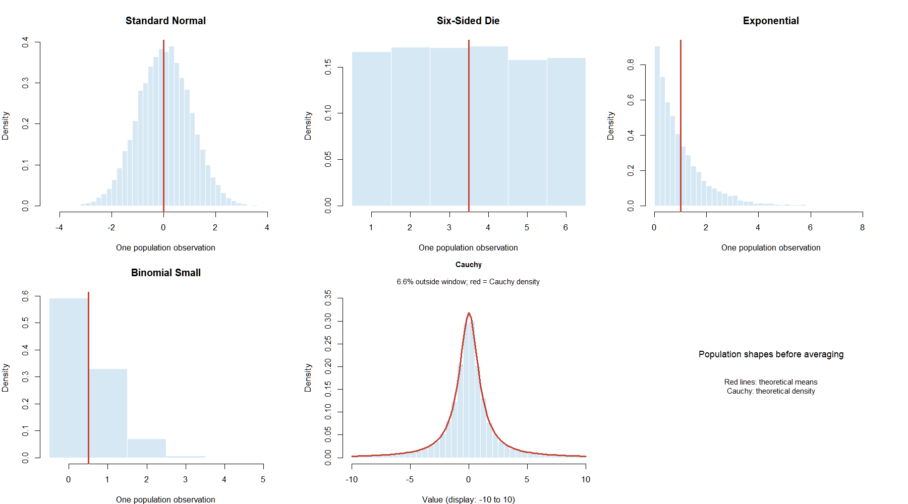
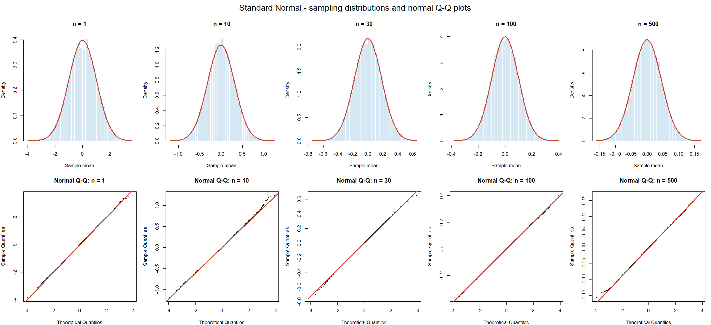
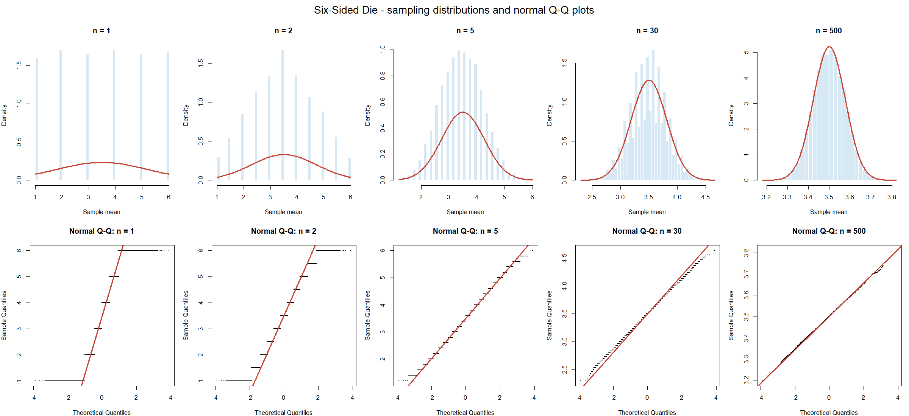
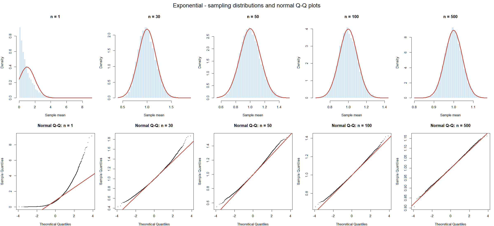
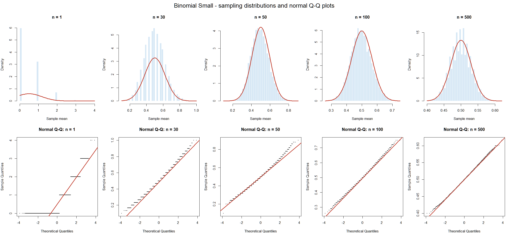
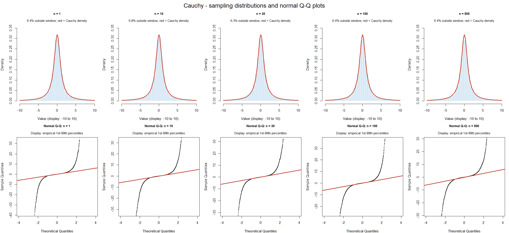
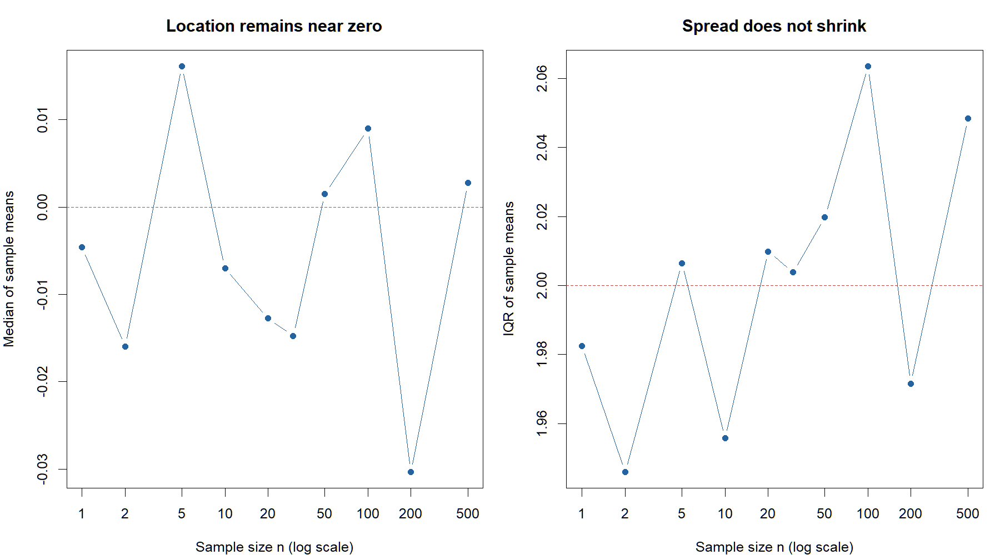
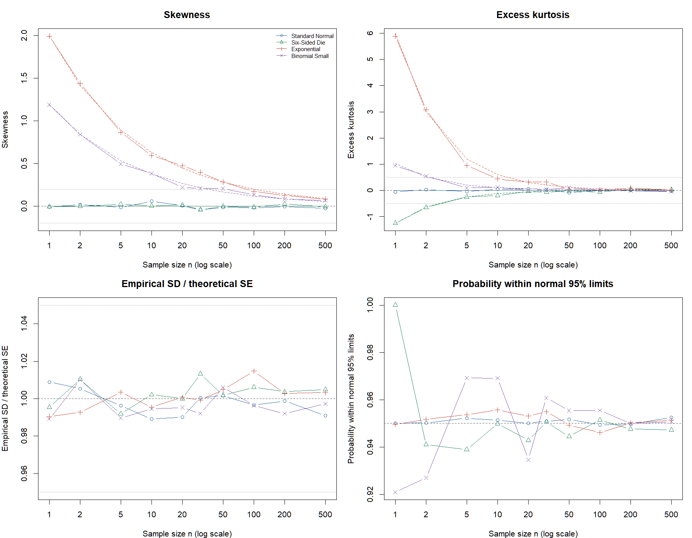

```{r}
#| label: setup
#| include: false
source("project1.R")
```

## Executive summary

This investigation compares sampling distributions of means from five populations.
Each scenario uses `r format(number_of_simulations, big.mark = ",")` independent samples;
the sample sizes are `r paste(sample_size_n, collapse = ", ")`. The configured seed is
`r student_seed`, based on the four digits supplied by the student.

There is no universal rule that a sample size of 30 produces a sufficiently normal
sampling distribution. Normal population means are exactly normal for every sample
size. The die, exponential, and small binomial have finite variance but different
degrees of discreteness and skewness, so their normal approximations improve at
different rates. Cauchy means remain Cauchy at every sample size.

```{r}
executive_table <- final_summary[, c(
  "distribution", "first_tested_n_passing_screen", "first_tested_n_all_larger_pass",
  "n30_screen_pass", "n30_skewness", "n30_excess_kurtosis", "n30_se_ratio")]
names(executive_table) <- c("Population", "First tested n passing", "First n with all larger passing",
                           "n=30 passes", "n=30 skewness", "n=30 excess kurtosis", "n=30 SE ratio")
knitr::kable(executive_table, digits = 3, caption = "Provisional numerical screening results. Cauchy screening is inapplicable.")
```

The table reports numerical screening results, which must be interpreted with the
plots below. A first passing sample size is a result on this tested grid, rather
than an exact minimum or a universal normality threshold. `NA` denotes an undefined
or inapplicable quantity, or that no tested size passed.

## Predictions and population assumptions

All generated observations within and between samples are independent. Each
population also has identically distributed observations. The ordinary CLT applies
to the four populations with finite variance. Cauchy violates the finite-variance
assumption; its population mean is also undefined.

```{r}
knitr::kable(population_parameters, digits = 3,
             caption = "Theoretical population properties and predictions specified before simulation.")
```



For the small binomial, one population observation counts successes in five trials
with success probability 0.10. The simulation's sample size $n$ counts independent
binomial observations; it is separate from the five trials per observation.

## Simulation design and criteria

For each population and each $n$, generate `r number_of_simulations` new independent
samples and compute each sample mean. The R code processes samples in batches to
limit memory use. A separate deterministic seed for each population and sample size
makes existing scenarios reproducible when the grid is expanded.

For finite-variance populations, theory gives

$$E[\bar X]=\mu, \qquad \mathrm{SE}(\bar X)=\frac{\sigma}{\sqrt n}.$$

The empirical SD of the simulated sample means estimates this standard error.
The Monte Carlo SE of their simulated average is a different quantity:

$$\mathrm{MCSE}\left(\frac{1}{B}\sum_{b=1}^{B}\bar X_b\right)
=\frac{\sigma}{\sqrt{nB}},$$

where $B$ is the number of simulations. The exported summary includes mean error
in units of this MCSE to help distinguish simulation noise from systematic errors.

The provisional numerical screen requires all three conditions:

- Absolute skewness at most `r skewness_limit`.
- Absolute **excess** kurtosis at most `r excess_kurtosis_limit`; normal excess kurtosis is zero.
- Empirical SD divided by theoretical SE within `r 100 * se_relative_error_limit`% of one.

These are project-specific criteria. SE agreement alone does not establish
normality, and the shape estimates themselves contain Monte Carlo noise. Histograms
and normal Q-Q plots supply complementary evidence, especially for discreteness,
asymmetry, and tail departures. No normality-test p-value determines the conclusion.

An additional diagnostic measures the fraction of sample means inside
$\mu \pm 1.96\sigma/\sqrt n$. Approximately normal distributions should give about
95% coverage, but a similar central probability alone does not establish normality.
The summary also reports the Monte Carlo SE of this estimated probability.

## Results by population

### Standard normal: baseline

Sample means are exactly $N(0,1/n)$ at every $n$. Departures of simulated moments
from their theoretical values reflect Monte Carlo noise. This case checks whether
the simulation and summaries reproduce known behavior.



### Six-sided die: symmetric and discrete

The population mean is 3.5 and variance is $35/12$. Small-sample means occupy a
finite lattice, visible as steps in the Q-Q plots. Symmetry makes population
skewness zero, but does not make the population normal. Its excess kurtosis is
$-222/175$, and the excess kurtosis of its sample means is $(-222/175)/n$.



### Exponential: persistent right skew

The population mean and SD are both one. The skewness of sample means is
$2/\sqrt n$ and their excess kurtosis is $6/n$. At $n=30$, theoretical skewness is
approximately `r round(2 / sqrt(30), 3)`, above the chosen cutoff of
`r skewness_limit`. The theoretical skewness reaches 0.20 at $n=100$, so Monte
Carlo fluctuations can change whether that particular scenario passes the screen.



### Small binomial: skewness and discreteness

The population mean is 0.5 and variance is 0.45. The sum of $n$ such independent
observations is exactly $\operatorname{Binomial}(5n,0.10)$, and dividing this sum by
$n$ gives the sample mean. Its skewness is $(0.8/\sqrt{0.45})/\sqrt n$ and excess
kurtosis is $[(1-6(0.1)(0.9))/0.45]/n$. At $n=30$, theoretical skewness is about
`r round((0.8 / sqrt(0.45)) / sqrt(30), 3)`. Inspect both tail curvature and the
remaining lattice pattern when judging the approximation.



### Cauchy: why the assumptions matter

For independent standard Cauchy observations, the sample mean has the same standard
Cauchy distribution for every $n$. Its theoretical median is zero and IQR is two;
its spread does not decrease as $1/\sqrt n$. Its mean and variance are undefined,
so the ordinary CLT and usual theoretical SE formula do not apply.

Finite simulated means and SDs can be computed, but they are only descriptions of
these particular runs. They do not estimate finite population moments. Cauchy
skewness, kurtosis, theoretical SE, and normal coverage are deliberately marked
`NA` in the summaries.





## Comparison with theory



The full table compares simulated means and SDs with theory, shape estimates with
their exact predictions, and normal-window coverage with 0.95. Large moment
departures should be interpreted together with the plots and Monte Carlo error.

```{r}
#| label: full-results
comparison <- simulation_summary[, c(
  "distribution", "n", "simulated_mean", "theoretical_mean", "empirical_sd",
  "theoretical_se", "mean_error_in_mc_se", "skewness", "theoretical_skewness",
  "excess_kurtosis", "theoretical_excess_kurtosis", "normal_95_coverage",
  "numeric_screen_pass")]
knitr::kable(comparison, digits = 3, caption = "All simulated scenarios; Cauchy mean and SD are descriptive only.")
```

## Limitations and conclusions

The first passing size depends on the chosen thresholds, the tested grid, and
simulation noise. A histogram can obscure discreteness through binning, while a
Q-Q plot may reveal tail departures even when numerical criteria pass. The Cauchy
display windows make the central shape readable, but hide the most extreme points
from the display; their presence is explicitly documented and they are retained
in all computations. Optional dependent, non-identical, and mixture examples are
outside this five-population investigation.

The normal population provides an exact baseline; the die and binomial demonstrate
the role of discreteness; exponential data demonstrate gradual reduction of
skewness; and Cauchy demonstrates failure of the finite-variance assumption. The
appropriate sample size depends on the population and on the accuracy needed for
the intended use of the normal approximation.

## Reproducing the analysis

From the repository root, run `source("Project1/project1.R")` in R to generate the
tables, plots, and text executive summary. Alternatively use
`Rscript Project1/project1.R`. Render this report with
`quarto render Project1/project1_report.qmd`.

The simulation uses only base R; rendering requires Quarto, knitr, and rmarkdown.
Run settings and R session information are saved in `results/analysis_settings.txt`
and `results/session_info.txt`. AI prompts and validation are documented separately
in `ai_prompt_log.txt`. Review the figures and explanations before submission.
