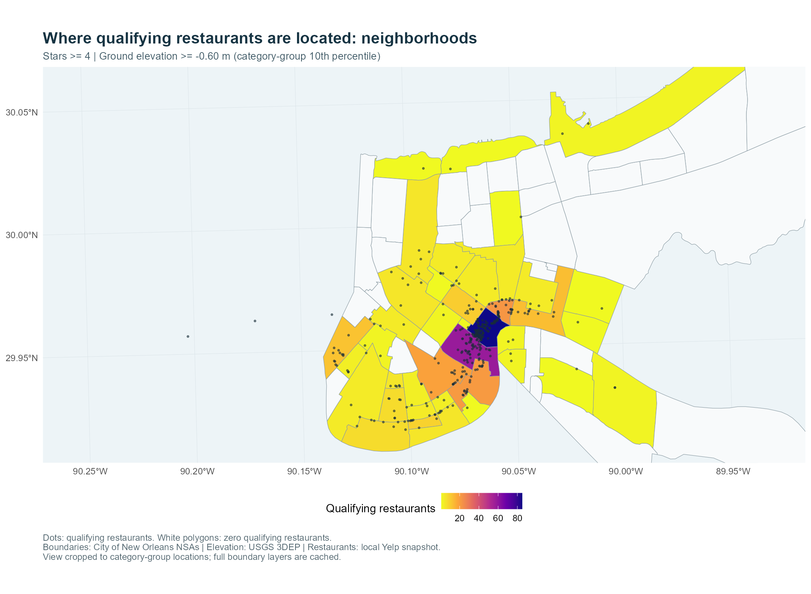
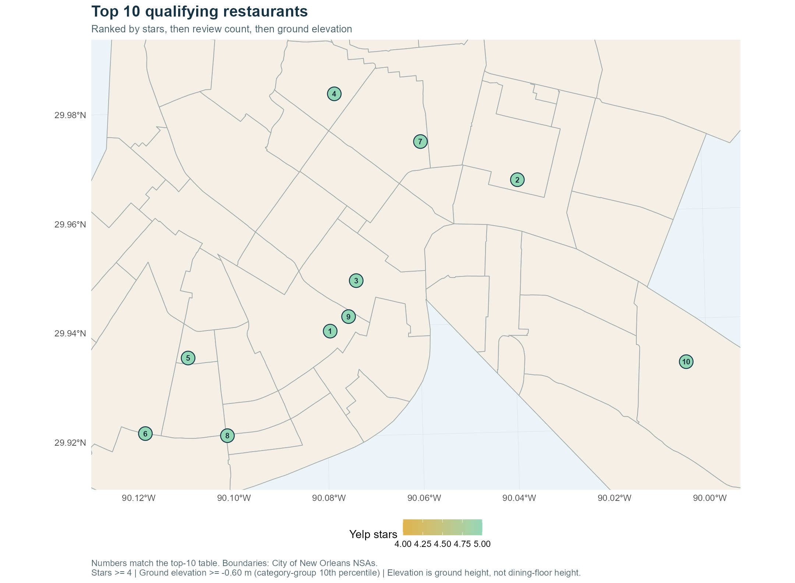

# MATH167R
Data analysis projects from R Programming

## Project 1: Monte Carlo Investigation of the Central Limit Theorem

Uses reproducible Monte Carlo simulations in R to investigate how the sampling
distribution of the mean changes with sample size for five populations: standard
normal, six-sided die, exponential, small binomial, and Cauchy.

The analysis compares simulated means and standard errors with theory, examines
histograms and Q-Q plots, and uses skewness and excess kurtosis to assess normal
approximations. It explores why there is no universal sample-size cutoff and why
the ordinary CLT does not apply to Cauchy data.

- [R analysis](Project1/project1.R)
- [Quarto report source](Project1/project1_report.qmd)
- [Rendered HTML report](Project1/project1_report.html)
- [Results, plots, and executive summary](Project1/results/)
- [AI assistance log](Project1/ai_prompt_log.txt)

Run the analysis from the repository root in R:

```r
source("Project1/project1.R")
```

Render the report from the repository root in a terminal:

```sh
quarto render Project1/project1_report.qmd
```

## Project 2: New Orleans Restaurant Ratings, Elevation, and Geography

**Research question:** Which New Orleans restaurants offering Cajun/Creole food,
cafe dining, or arts and entertainment combine good Yelp ratings with ground
elevation at or above the category group's 10th percentile, and where are they
located?

Uses the Yelp Open Dataset, USGS 3DEP ground elevations, City of New Orleans
Neighborhood Statistical Areas, and 2024 Census tract boundaries. The R workflow
imports JSON, saves a smaller New Orleans RDS file, separates category labels,
and uses spatial joins to compare restaurant locations across two geographic
systems.

A business must have the `Restaurants` label and at least one of `Cajun/Creole`,
`Cafes`, or `Arts & Entertainment`. Of 618 distinct restaurants in this group,
**344 qualify** with at least 4 Yelp business stars and ground elevation at or
above **-0.604 meters**. The 10th percentile is a lower cutoff that retains
roughly 90% of the group by elevation before filtering ratings.

### Main findings

| Neighborhood | Qualifying restaurants | Average business stars |
|---|---:|---:|
| French Quarter | 85 | 4.14 |
| Central Business District | 58 | 4.16 |
| Marigny | 22 | 4.09 |
| Lower Garden District | 21 | 4.26 |
| Central City | 19 | 4.32 |

Qualifying restaurants span **40 neighborhoods and 69 census tracts**; three
qualifying locations are unmatched to either boundary layer. Neighborhoods
provide recognizable area names and fewer sparse comparisons than census
tracts. Map colors show the number of qualifying restaurants in each area.





The results reflect the downloaded Yelp snapshot, including 103 qualifying
businesses marked closed. The restaurant tables show snapshot status. This
stage uses business stars; individual-review and reviewer-normalized ratings
are not yet included.

### Report, tables, and source code

- [HTML report with searchable tables and inspectable maps](Project2/Yelp-JSON/results/geography/new_orleans_geography.html) — download and open in a browser; GitHub's file view shows HTML source.
- [All qualifying restaurants](Project2/Yelp-JSON/results/geography/qualifying_restaurants.csv)
- [Top 10 restaurants](Project2/Yelp-JSON/results/geography/top_10_restaurants.csv)
- [Neighborhood summary](Project2/Yelp-JSON/results/geography/neighborhood_summary.csv)
- [Census tract summary](Project2/Yelp-JSON/results/geography/census_tract_summary.csv)
- [Geographic system comparison](Project2/Yelp-JSON/results/geography/geography_comparison.csv)
- [Category counts](Project2/Yelp-JSON/results/geography/category_summary.csv) and [category co-occurrence](Project2/Yelp-JSON/results/geography/category_cooccurrence.csv)
- [All exported maps](Project2/Yelp-JSON/results/geography/maps/)
- [JSON import and New Orleans filtering](Project2/Yelp-JSON/project2.R)
- [Dataset and category exploration](Project2/Yelp-JSON/view_ds.R)
- [Geographic and elevation analysis](Project2/Yelp-JSON/geographic_analysis.R)
- [Assignment instructions](Project2/yelp%20new%20orleans%20project%20instructions.qmd)

### Data and reproduction

Download the [Yelp Open Dataset](https://business.yelp.com/data/resources/open-dataset/)
and extract the business JSON to
`Project2/Yelp-JSON/Yelp JSON/yelp_dataset/yelp_academic_dataset_business.json`.
The large raw JSON files stay local and are excluded by `.gitignore`.
The filtered business data is saved under `Project2/Yelp-JSON/data/new_orleans/`;
geographic boundaries and elevation responses are cached under
`Project2/Yelp-JSON/data/geography/`.

Required packages: `tidyverse`, `jsonlite`, `sf`, `tigris`, `curl`, and `ragg`.
From an R session at the repository root:

```r
# Rebuild the filtered business data if needed:
source("Project2/Yelp-JSON/project2.R")

# Generate the tables, maps, and HTML report:
source("Project2/Yelp-JSON/geographic_analysis.R")
```

The geographic analysis reuses cached inputs when available. Missing boundary
and elevation inputs require internet access. Outputs are saved under
`Project2/Yelp-JSON/results/geography/`; the figures and CSV tables can be viewed
without running R.

## Homework 3: World Map and Personal Places

Uses `sf`, `rnaturalearth`, and `ggplot2` to map estimated GDP per country in
millions of US dollars. The GDP map includes a logarithmic color scale, legend,
title, and explanatory subtitle. GDP estimate years vary by country.

A second map adds three places to visit: Lapland in Finland (represented by
Rovaniemi), Uyuni in Bolivia, and Seljalandsfoss in Iceland. Each location has
a distinct point color and shape, a name label, and a shared dashed connecting
line. The line illustrates the connection between locations.

- [Homework instructions](hw3/HW%203-%20world_map_homework.pdf)
- [R script](hw3/hw_3.R)
- [GDP world map](hw3/hw3_gdp_map.png)
- [GDP map with selected locations](hw3/hw3_places_map.png)
- [AI prompt log](hw3/ai_prompt_log.txt)

From an R session at the repository root, switch to the homework directory
before running the script so both PNG files are saved inside `hw3/`:

```r
setwd("hw3")
source("hw_3.R")
```

Required packages: `sf`, `ggplot2`, `rnaturalearth`, `rnaturalearthdata`, and
`scales`.
